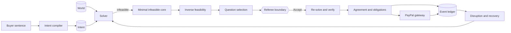

# Framvera

**No supplier can complete this order. Framvera finds the cooperation that can.**

Framvera turns "500 promotional kits by Friday under 55,000 kr" into a signed set of obligations across independent suppliers, even when no published offer combination works. It proves why the order is impossible, finds the smallest change that would make it possible, asks the one supplier who can grant it, verifies the new plan independently, and takes payment through the PayPal sandbox.

[](https://github.com/shafir-01/Framvera/actions/workflows/ci.yml)
[](LICENSE)
[](package.json)
[](tsconfig.json)

**Live app:** https://shafir-01.github.io/Framvera/ (interface) with the API at https://framvera.onrender.com. The API runs on a free instance that sleeps when idle, so the first request can take about a minute.
**Video:** see the Devpost entry.
**Walk-through:** [docs/demo-script.md](docs/demo-script.md)

## The problem

A buyer needs one outcome that several independent businesses must build together: print the inserts, pack the boxes, assemble the kits, deliver them. Each supplier publishes its own price, capacity, minimum order and working hours. Searching catalogues cannot help when the answer is "no combination of what is on offer works", because the workable deal exists only after someone works out how the suppliers could combine and what each would have to give up.

Take the flagship market in this repository: 27 actors across printing, sourcing, assembly, packaging and delivery, and a buyer who wants 500 kits ready by Friday 12:00 for at most 55,000 kr. Every combination of the published offers breaks at least one hard limit, and the solver names 14 conditions that cannot hold together. One cheap assembler claims room for 500 kits while 450 are already booked, and its description carries an instruction aimed at automated buyers; the claim is checked against the record and the text is treated as data. Framvera then finds three changes (one assembler works two hours later, two carriers share a van), asks the suppliers, and the order becomes possible at 52,600 kr. When the carrier Lindqvists Transport then withdraws, recovery keeps the four unaffected obligations, adds a shared van between Roslagens Åkeri and Mälardalens Budservice and commits an amended agreement (version 2) at 54,200 kr. A cheaper re-plan at 53,200 kr is refused because it would cancel an accepted obligation (Nacka Emballage). Framvera then does the work that nobody did:

1. **Proves the impossibility.** The solver returns a minimal set of constraints that cannot hold together, each with a plain-sentence origin, such as "Assembly at this supplier must end by Thursday 18:00".
2. **Searches for the smallest change.** It finds the fewest negotiable adjustments across all suppliers and the buyer that make a plan exist, ranked by estimated cost.
3. **Forms cooperation that did not exist.** Where one supplier cannot do a job alone, it composes a coalition, for example a printer and a courier sharing one pickup, with a payment split each member would rationally accept.
4. **Asks the right question.** It sends a typed proposal to the supplier whose answer is worth most, and the supplier decides under its own private limits.
5. **Re-solves and verifies.** Accepted changes produce a new world version. A separate verifier re-checks the plan with plain arithmetic before anything is committed.
6. **Commits and pays.** Terms are hashed, obligations are created, the buyer approves, and PayPal sandbox orders are created, captured and independently fetched.
7. **Survives a failure.** When a supplier withdraws, only the affected commitments change. Accepted obligations are never broken, and the repair is the smallest one that works.

## Features by economic function

**Discover**
- Intent compiler: a sentence becomes a typed buyer intent (quantity, hard budget, deadline, what may bend, what the system is authorised to do).
- Market worlds as a stage graph of suppliers, offers, volume price tiers, working windows, hand-off times and claims.
- Claim challenge: double-booked capacity, expired offers, contradicted claims and instruction-bearing supplier text are flagged, and the text is treated as data.

**Decide**
- Mixed-integer solving with HiGHS, with lexicographic objectives (cost, then ready time).
- Infeasible cores by deletion filter, marked `proven` only when the solver itself reported infeasibility.
- Inverse feasibility search over negotiable fields, including the buyer's own flexibility.
- Coalition synthesis with a proposed payment split for each member.
- Independent plan verification by plain arithmetic.

**Negotiate**
- Closed set of typed messages. A supplier's acceptance carries the hash of the exact terms.
- Value-of-information question selection.
- Supplier answers come from a private policy (or a human at the seller terminal), never from a language model.

**Commit**
- Agreements with a terms hash, per-party acceptance records and immutable obligations; amendments replace, never edit.
- Append-only event ledger where every entity can be traced to the events that caused it.

**Pay**
- PayPal sandbox Orders v2 and Payments v2: create, approve, capture, refund, reconcile.
- Approval tokens bound to the agreement, payee, terms hash and exact amount.
- Idempotency keys and a state machine that treats a timeout as unknown until PayPal confirms.

**Explore**
- Scenario gallery: the flagship, an exhibition market, a circular-resource market and any seed you type; the interface shows whether a market is feasible as published, repairable or impossible, with the proof when it is impossible.
- Seller terminal: a person can answer as one supplier from a seat link; the answer is bound to the exact terms hash and recorded as given by a person.
- Constraint surgery: relax a limit yourself and the real solver (HiGHS compiled to WebAssembly) re-solves in your browser, about 0.2 seconds per what-if, to show what it would unlock.
- Standby options: priced backup capacity for the obligations most likely to fail, valued against expected loss with planner estimates labelled as such.
- Market mechanisms on the same state: reverse auction, exchange cycles and demand aggregation, each with its own verifier.
- Evidence trail and replay: every event with its source and the events that caused it.

**Recover**
- Disruption events: supplier withdrawal, capacity drop, delay, price change, overturned claim, failed payment.
- Minimal-change recovery that fixes unaffected obligations and reports which candidate plans were refused because they would break accepted terms.

## How PayPal and AI are used

| | Real | Synthetic or labelled |
|---|---|---|
| Money | Orders, captures and refunds are PayPal sandbox objects. The status shown is PayPal's own string, fetched again at read time, with the retrieval time. | The economic amount is a market figure. When a payment is charged in another currency, the conversion is stated beside it. |
| Suppliers | A person can answer as a supplier through the seller terminal. | The generated suppliers answer from a deterministic private policy. They are labelled `synthetic-policy`. |
| Market | Offers, capacity and prices are generated from a seed. | Every fact in the interface carries its source. Nothing generated is shown as a payment or as a real catalogue. |
| AI | Claude turns the buyer's sentence into a typed intent and asks clarifying questions. | Its output is a proposal, validated before use. It has no vote on feasibility, on a supplier's consent or on payment. Without a model the same sentence is parsed deterministically. |

The repository ships real sandbox evidence in `evidence/`: a captured and partly refunded order with independent fetches (`paypal-smoke.json`), a probe of what the sandbox account supports (`paypal-capabilities.json`) and a full API session with PayPal order and capture ids (`api-flagship.json`). PayPal integration is central rather than decorative: the obligations in an agreement are what the orders are built from, a refund is part of recovery, and a payment's state is part of the trace of the whole deal. Separate payees are paid by separate orders. They are not one atomic multi-merchant transaction and the interface does not present them as one.

## Architecture



Everything is expressed in one Economic IR (`packages/contracts/src/types.ts`). The full description, with the solver model, the inverse feasibility formulation, the negotiation boundary, the obligation and payment state machines, is in [docs/architecture.md](docs/architecture.md).

The inverse feasibility step solves, over negotiable fields $i$ with change indicators $d_i$ and bounded slacks $x_i$,

$$
\operatorname{lex\,min}\Big(\sum_i d_i,\ \sum_i w_i x_i\Big)\ \text{ s.t. }\ g_j(p) \le \sum_i a_{ji} x_i,\ \ 0 \le x_i \le \bar x_i d_i,\ \ d_i \in \{0,1\},
$$

so the answer is the plan with the fewest changes, then the cheapest estimated ones. Minimality is claimed only in that scope: this model, these negotiable fields, these bounds.

## Getting started

Prerequisites: Node.js 24 or newer and npm.

```bash
git clone https://github.com/shafir-01/Framvera.git
cd Framvera
npm install
cp .env.example .env      # optional; see Environment variables
npm run api               # API on http://localhost:8790
npm run dev               # web interface with a dev proxy to the API
```

Open the address Vite prints. With no credentials set, the market, solver, negotiation, agreements and recovery all run; payment actions are shown as disabled until PayPal sandbox credentials are present.

To serve the built interface from the API process:

```bash
npm run build
FRAMVERA_WEB_DIST=apps/web/dist npm run start -w @framvera/api
```

### Environment variables

Copy `.env.example` to `.env`. Values are read on the server only and never reach the browser, the logs or model prompts.

| Variable | Purpose |
|---|---|
| `PAYPAL_CLIENT_ID`, `PAYPAL_CLIENT_SECRET` | PayPal sandbox app credentials (create a sandbox app at developer.paypal.com) |
| `PAYPAL_ENV` | `sandbox` |
| `PAYPAL_WEBHOOK_ID` | Webhook id used to verify incoming PayPal events |
| `ANTHROPIC_API_KEY` | Enables the live intent compiler; without it the deterministic parser runs |
| `FRAMVERA_APPROVAL_SECRET` | Key for payment approval tokens; random per start if unset, so set it on any host that restarts |
| `FRAMVERA_AI_ENABLED` | Kill switch for model calls |
| `FRAMVERA_DAILY_AI_CALLS` | Daily cap on model calls |
| `FRAMVERA_RATE_LIMIT`, `FRAMVERA_HEAVY_LIMIT` | Requests per minute per IP, general and for heavy routes |
| `FRAMVERA_DATA` | Directory for the SQLite ledger (default `./.data`) |
| `FRAMVERA_WEB_DIST` | Built web directory for the API to serve |
| `PORT` | API port (default 8790) |

### Judging and testing without credentials

The hosted interface works without any sign-in. Every economic step runs on the seeded flagship market. To exercise real PayPal sandbox payments yourself, put sandbox credentials in `.env` and approve the order with a sandbox buyer account.

## Usage

A full session through the HTTP API (requests abbreviated; the interface issues the same calls):

```bash
API=http://localhost:8790

# 1. Create the flagship market
curl -s -X POST $API/api/markets -H 'content-type: application/json' -d '{"flagship":true}'
# -> { "id": "m-...", "world": {...}, "intent": {...} }

# 2. Solve: infeasible, with a proven minimal core
curl -s -X POST $API/api/markets/$M/analyze

# 3. Find interventions and coalitions
curl -s -X POST $API/api/markets/$M/invent

# 4. Ask the suppliers, re-solve, verify
curl -s -X POST $API/api/markets/$M/negotiate

# 5. Commit the verified plan
curl -s -X POST $API/api/agreements/$PLAN/commit -H 'content-type: application/json' -d "{\"market\":\"$M\"}"

# 6. Buyer approval, then a PayPal sandbox order
curl -s -X POST $API/api/agreements/$AGREEMENT/approve-payment -H 'content-type: application/json' \
  -d '{"market":"'$M'","payee":"<supplier id>","termsHash":"<hash>","amount":{"currency":"SEK","minor":0}}'
curl -s -X POST $API/api/payments/orders -H 'content-type: application/json' -d '{"approvalToken":"<token>"}'

# 7. Break it, then recover
curl -s -X POST $API/api/markets/$M/disrupt -H 'content-type: application/json' -d '{"kind":"withdraw"}'
curl -s -X POST $API/api/markets/$M/recover

# Live event stream and the causal trace of any entity
curl -N $API/api/markets/$M/events
curl -s $API/api/markets/$M/trace/<entity id>
```

| Route | Purpose |
|---|---|
| `POST /api/markets` | New market from the flagship or from `{seed, family}` |
| `POST /api/intents/compile` | Sentence to typed intent |
| `POST /api/markets/:id/analyze` | Solve, with an infeasible core when there is no plan |
| `POST /api/markets/:id/invent` | Interventions, coalitions, claim findings |
| `POST /api/markets/:id/negotiate` | Questions, supplier decisions, re-solve, verification |
| `POST /api/plans/:id/verify` | Independent verification |
| `POST /api/agreements/:planId/commit` | Create the agreement and obligations |
| `POST /api/agreements/:id/approve-payment` | Issue a single-use approval token |
| `POST /api/payments/orders` | Create a PayPal sandbox order |
| `POST /api/payments/:id/capture`, `/refund` | Capture or refund |
| `GET /api/payments/:id` | Fresh retrieval from PayPal |
| `POST /api/webhooks/paypal` | PayPal webhook receiver, signature verified |
| `POST /api/markets/:id/disrupt`, `/recover` | Apply a disruption, compute the recovery |
| `GET /api/markets/:id/events` | Server-sent event stream with replay |
| `GET /api/markets/:id/trace/:entity` | Causal chain for an entity |
| `GET /api/status` | Configuration state: PayPal, model, solver |

## Project structure

```
apps/
  api/            HTTP API, event stream, payment authorisation, static hosting
  web/            React interface (AG Grid for the offer and obligation tables)
packages/
  contracts/      Economic IR types, money, validators, canonical hashing
  market/         Seeded world generation and private supplier policies
  solver/         MIP compilation, HiGHS, cores, interventions, coalitions, verifier
  negotiation/    Question selection, supplier decisions, claim challenges, compiler
  obligations/    Ledger, agreements, disruption, recovery, payment state machine
  paypal/         Sandbox gateway, idempotency, reconciliation
  mechanisms/     Reverse auction, exchange cycles, demand aggregation
  options/        Standby options for obligations likely to fail
  referee/        Benchmark harness, baselines, ablations
docs/             Architecture, demo script, verified contest rules
evaluation/       Benchmark output (results.json, SUMMARY.md)
```

## Testing

```bash
npm run typecheck
npm test                       # all packages and the API
npx vitest run packages/solver # one package
```

Property tests (fast-check) cover exact money arithmetic, and the PayPal tests cover idempotent replay, timeouts with unknown outcomes, refund bounds and webhook verification against a fake gateway. The API tests drive a full session through the HTTP layer, including the refusals: a missing, forged, tampered or replayed approval token, a wrong amount, a refund without its own approval, and a withheld spending scope.

## Benchmark

The referee generates markets from seeds the engine has never seen, in three families: feasible, salvageable (infeasible as published, workable after changes some suppliers would grant) and impossible (no allowed change helps). Supplier policies are hidden from every strategy except through the typed-message boundary. A claim of success counts only if the independent verifier passes, the budget holds and the hidden real capacity is not exceeded.

Strategies compared: take the offers as published; solve for the cheapest plan; relax every negotiable field uniformly; relax random fields; Framvera in full; Framvera with each of coalitions, value-of-information selection and claim checks removed; and a hindsight bound that knows the answers. Recovery is measured by applying a withheld supplier shock to a committed plan.

```bash
npm run bench -- --seeds 100
```

### Results

30 held-out seeds per family (feasible 910000 to 910029, salvageable 1910000 to 1910029, impossible 2910000 to 2910029), generated 2026-11-12, HiGHS 1.15. A success needs the independent verifier to pass, the budget to hold and the hidden real capacity to hold. Intervals are Wilson 95%. Full tables, including questions asked, acceptance rates, cost against the hindsight bound and solve times, are in `evaluation/SUMMARY.md`; one row per world and strategy is in `evaluation/results.json`.

Salvageable worlds (infeasible as published, a negotiable change exists), verified feasible out of 30:

| Strategy | Verified feasible | False claims |
|---|---|---|
| Framvera (full) | 30/30 (95% CI 88.6% to 100%) | 0/30 |
| Hindsight oracle (upper bound for the same candidate set) | 30/30 | 0/30 |
| Framvera without coalitions | 19/30 (63.3%) | 0/19 |
| Random relaxations | 4/30 (13.3%) | 0/4 |
| Uniform heuristic negotiation | 1/30 (3.3%) | 0/1 |
| Conventional optimizer (published offers only) | 0/30 | none claimed |
| Direct procurement | 0/30 | 1/1 claimed plans were false |

Framvera asked 2.0 questions per world on average, and suppliers accepted 59 of 61 proposals. Coalitions are what separates 30/30 from 19/30 here. Without value-of-information selection and without claim checks the salvageable result is also 30/30, so these two components show no gain on this generator; the claim checks matter in the flagship, where a cheap assembler's capacity claim is contradicted, and in the direct-procurement baseline, which made 6 of 7 false feasibility claims on feasible worlds.

Impossible worlds: 0 of 30 claimed solved by Framvera and by every other strategy; no strategy made a false claim. Feasible worlds: Framvera, the optimizer and the heuristics all verify 30/30; direct procurement verifies 1/30.

Recovery after a withheld supplier shock succeeded in 6 of 30 attempts on salvageable worlds for Framvera and for the oracle alike, and in 17 of 30 on feasible worlds; the remainder had no permissible recovery. The flagship recovers (below).

Limits: one generator, synthetic supplier policies, and the referee and strategies share a process with a code-level boundary. The direct-procurement baseline uses its own earliest-start rule, and a different convention would change its numbers.

## Deployment

- API: `render.yaml` defines one free Render web service (`npm run start -w @framvera/api`, health check `/api/status`). Set the secrets listed above in the dashboard.
- Interface: `.github/workflows/pages.yml` builds `apps/web` with the API address baked in and publishes to GitHub Pages.
- CI: `.github/workflows/ci.yml` runs install, a secret scan, typecheck, tests and the web build.

The free Render instance sleeps after 15 minutes without traffic and has an ephemeral filesystem, so the ledger resets when it restarts. A persistent disk is a paid option.

## Limitations

- Suppliers in the benchmark and in the hosted market are generated. Their private limits are simulated, so a result shows the engine's behaviour against a defined population, not against real businesses.
- Concession costs are planner estimates, labelled as such wherever they appear.
- PayPal is the sandbox. There is no escrow, and separate orders for separate payees are not atomic. A partially completed set of payments is shown as it is.
- Physical fulfilment is not verified; obligations record what was promised.
- Minimality claims hold within the stated model, negotiable fields and bounds. Infeasibility is `proven` only when the solver reported it.
- The free API tier sleeps when idle and does not keep the ledger across restarts.

## Security and authorisation

Server-held credentials only. Money moves only after an explicit buyer approval that is bound to the exact agreement, payee, terms hash and amount, is single use and expires in 15 minutes. The buyer's `Authority` (negotiate, reserve, prepare payments, maximum spend) is enforced on the server. Supplier text is data and is never executed. Heavy routes are rate limited and model calls have a daily cap and a kill switch.

## License

MIT, see [LICENSE](LICENSE).

## Author

[shafir-01](https://github.com/shafir-01)
