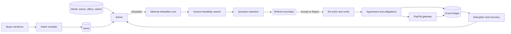
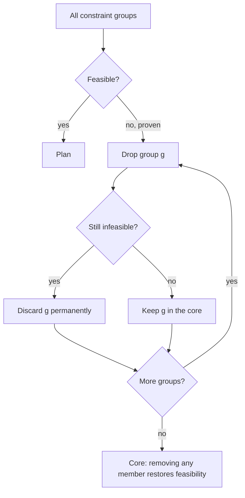
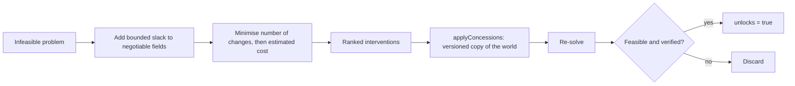
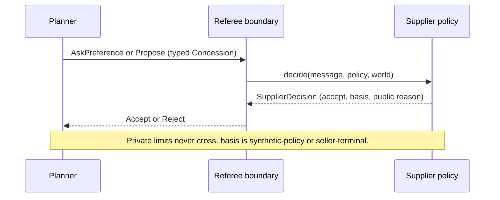
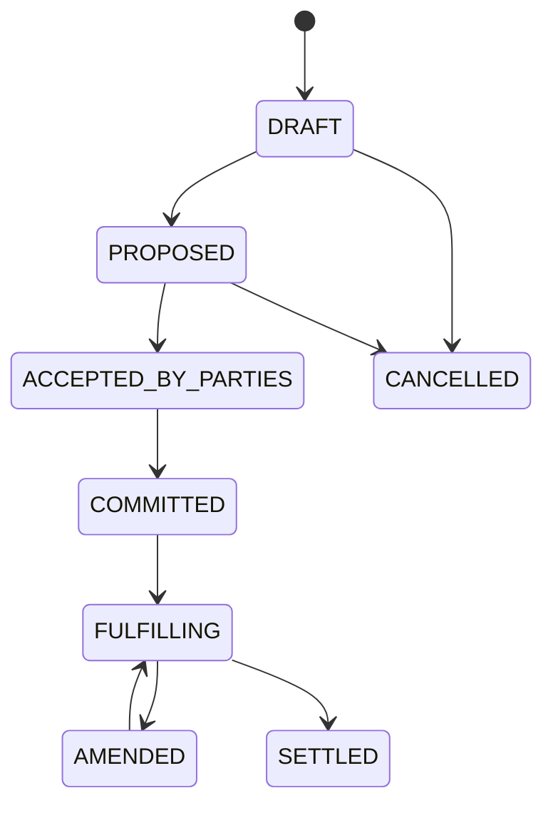
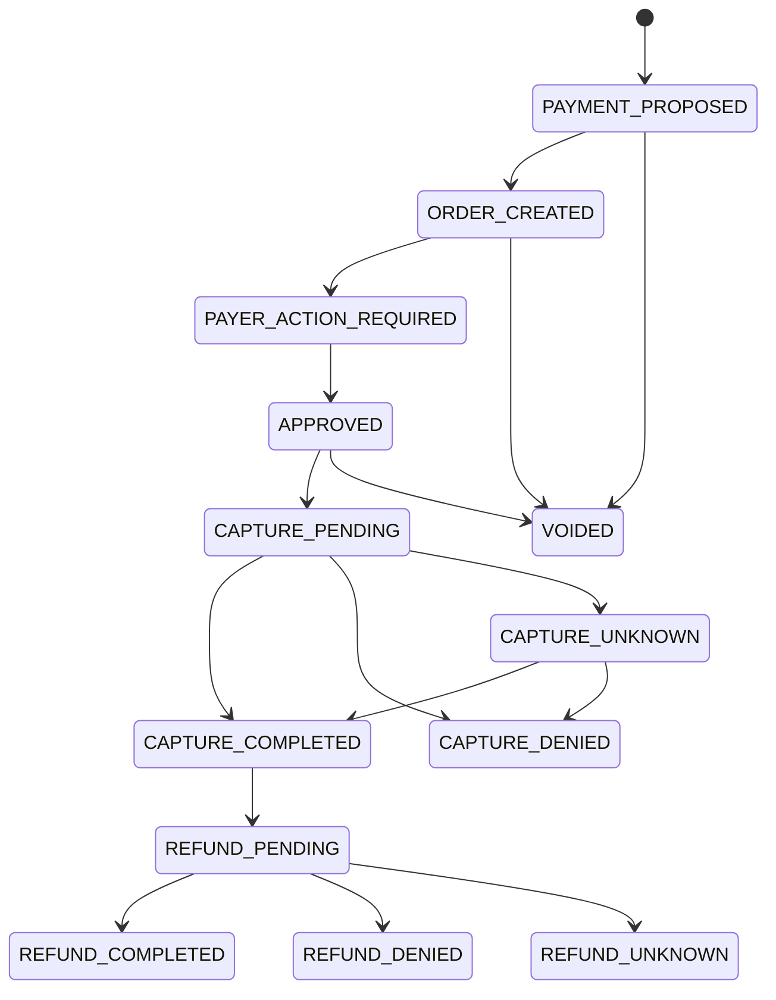

# Architecture

Framvera is a TypeScript monorepo. Every module speaks one shared vocabulary, the Economic Intermediate Representation (EIR), defined in `packages/contracts/src/types.ts`. A buyer's sentence is compiled into typed objects, the solver reasons over those objects, suppliers answer typed messages, accepted terms become hashed obligations, and PayPal executes the money. Each step leaves an event in an append-only ledger, so any number on screen can be traced back to the record that produced it.

## Packages

| Package | Responsibility |
|---|---|
| `contracts` | EIR types, exact money arithmetic, validators, canonical hashing |
| `market` | Seeded generation of market worlds, with supplier policies held apart from the public world |
| `solver` | Mixed-integer model compiled from an intent and a world, solved with HiGHS; infeasible cores, interventions, coalitions, independent plan verification |
| `negotiation` | Value-of-information question selection, supplier decisions, coalition payment splits, claim challenges, intent compilation |
| `obligations` | Append-only ledger, agreement commitment, disruption, minimal-change recovery, payment state machine |
| `paypal` | Gateway to the PayPal sandbox Orders and Payments APIs, idempotency, reconciliation |
| `referee` | Benchmark over generated worlds, with baselines, ablations and a hindsight bound |
| `apps/api` | HTTP API, event stream, authorisation of money movement |
| `apps/web` | The product interface |

## The Economic IR

An `Intent` holds the buyer's quantity, hard budget, deadline and the few things the buyer allows to bend, plus an `Authority` object that says what the system may do on the buyer's behalf. A `World` holds `Stage`s (a graph such as print, pack, assemble, deliver), `Actor`s and `Offer`s. An `Offer` is one supplier's claim: capacity, minimum quantity, rate, setup fee, price tiers, a working window, hand-off hours and the list of fields the supplier publicly signals it may negotiate.

Every fact carries `Provenance` with a `Source`: `synthetic-market`, `seller-terminal`, `buyer`, `model-proposal`, `solver`, `paypal-sandbox` or `external-catalog`. The interface shows the source and never blends them. Money is integer minor units. Time is UTC ISO.

## Solver

`solve(world, intent)` compiles the world into a mixed-integer linear program and solves it with HiGHS.

Per offer the model has a quantity $q_o$, a use indicator $u_o$, start and end times, and tier selectors for volume pricing. Constraint groups each keep a typed `ConstraintRef` with a plain-sentence origin:

- demand: each stage produces at least what the outcome needs;
- capacity and minimum quantity: $u_o\,m_o \le q_o \le u_o\,c_o$;
- window: work starts no earlier than the window start, ends no later than the window end, and takes at least $q_o / r_o$ hours at the offer's hourly rate;
- precedence with hand-off: a stage cannot start before its predecessors finish plus hand-off hours;
- deadline and budget;
- exclusive resource: one underlying capacity cannot be sold twice;
- validity: expired offers are unusable.

`verifyPlan(plan, world, intent)` re-checks a plan with plain arithmetic and shares no code path with the solver, so a solver bug cannot vouch for itself.

### Infeasible cores

When the model is infeasible, `explainInfeasible` runs a deletion filter over constraint groups. It removes one group at a time, keeps the removal if the model stays infeasible, and ends with a set where removing any single group restores feasibility. The report records `minimal` and `proven` separately: `proven` is true only when each infeasible verdict came from the solver's infeasibility status and not from a timeout. Minimality holds with respect to constraint groups, not individual inequalities.

## Inverse feasibility

Instead of asking "what is the cheapest plan", the engine asks "what is the smallest change that makes any plan exist". Every field a supplier signals as negotiable gets a bounded slack $x_i$ that relaxes its constraint, and so do the buyer's deadline and budget when the buyer allows them to bend. A binary $d_i$ records whether field $i$ was touched. With $g_j(x) \le 0$ the original constraints, $a_{ji}$ the effect of field $i$ on constraint $j$, $\bar x_i$ the largest permitted change and $w_i$ the planner's estimated cost per unit of change:

$$
\operatorname{lex\,min}\;\Big(\sum_i d_i,\ \ \sum_i w_i\,x_i\Big)
\quad\text{s.t.}\quad g_j(p) \le \sum_i a_{ji}\,x_i\ \ \forall j,\qquad 0 \le x_i \le \bar x_i\, d_i,\qquad d_i \in \{0,1\}.
$$

Here $p$ are the plan variables. The solver first minimises the number of changes, then, holding that count, the estimated cost. The bounds $\bar x_i$ are fixed in `packages/solver/src/compile.ts`: at most 168 hours of window shift, at most 30 percent off a unit price, and never more than the buyer's own stated flexibility on deadline and budget. A solution with every $x_i = 0$ exists only when the original problem is feasible.

The result is a ranked list of `Intervention`s. Each one is applied to a copy of the world with `applyConcessions` and re-solved. An intervention is reported as unlocking only when that re-solve is feasible and `verifyPlan` agrees. The minimality statement carried by each intervention names its scope: fewest changes under this model, these negotiable fields and these bounds. Cost figures on concessions are planner estimates and are labelled as such.

## Coalitions

A `Coalition` is a hyperedge: several actors jointly create a capability no single offer has, for example a printer and a courier sharing one pickup run. It lists the offers and quantities consumed from each member and a payment split. The split is checked for individual rationality against each member's outside-option estimate, and a member whose share falls below that estimate is flagged. Coalition members never allocate one underlying capacity twice.

## Negotiation boundary

Suppliers are not language models. Each synthetic supplier has a private `SupplierPolicy` (reservation values, risk tolerance, outside option) generated with the world and kept in the referee. The planner sees only the public world and the typed messages it sends.

Messages are a closed union: `RequestQuote`, `AskPreference`, `Propose`, `CounterOffer`, `Accept`, `Reject`, `Withdraw`, `Expire`. `Accept` carries the hash of the exact terms. Questions are chosen by value of information: the engine asks first the supplier whose answer most improves the chance of reaching a feasible plan for the cost of asking. A person can answer instead through the seller terminal, and that answer is recorded with basis `seller-terminal`.

Supplier descriptions are free text and are treated as untrusted data. They are quoted, never executed. `challengeClaims` flags capacity that is double-booked, offers that are expired, claims that are contradicted, and descriptions that contain instructions.

## Where the language model sits

Claude compiles a buyer's sentence into an `Intent` and produces clarifying questions. Its output carries `model-proposal` provenance, is validated against the intent schema before use, and has no authority over feasibility, acceptance or payment. When no model is reachable, a deterministic parser handles the same sentence and the interface says so. Everything after compilation is deterministic code.

## Obligations and recovery

`commit(plan, intent, decisions)` builds an `Agreement` whose `termsHash` is the SHA-256 of the canonical terms, with one `Obligation` per allocation. Acceptances reference that hash. A proposal without an acceptance from each party stays a draft.

When a disruption lands (a supplier withdraws, capacity drops, a claim is overturned), `recover` re-solves with the unaffected obligations fixed and an objective that measures distance from the original plan. Obligations are immutable: an amendment is a new obligation whose `replaces` points at the old one, and the old one moves to `REPLACED`. Candidate plans that would break an accepted commitment are listed in `rejected` with the reason. If no permissible recovery exists, the result carries the infeasible core and the concessions that would be needed.

## PayPal gateway

- Orders v2 and Payments v2 on the PayPal sandbox, authenticated server-side with OAuth client credentials. Credentials never reach the browser or the logs.
- Each payment has a durable `operationKey` that is also sent as the `PayPal-Request-Id` header, so a retry returns the stored result and cannot create a second order or capture.
- A timeout is never guessed. The state moves to `CAPTURE_UNKNOWN` or `REFUND_UNKNOWN`, and a retry first retrieves the order from PayPal (`reconcile`).
- The status shown for a payment is PayPal's own status string, fetched again at read time, with the retrieval timestamp.
- Money moves only after the buyer approves. The interface calls an approval endpoint that returns a short-lived HMAC token bound to the agreement, the payee, the terms hash and the exact amount. Order creation verifies the token, derives the amount from the obligations on the server, and consumes the token once. A refund needs its own token.
- Each payee is paid by a separate order. Separate captures are not one atomic multi-merchant transaction, and the interface does not present them as one.

## Event ledger

`Ledger` is an append-only SQLite store (`node:sqlite`). Each `MarketEvent` has a sequence number, a source, and `causes`, the ids of earlier events it depends on. The trace endpoint walks `causes` to show why any entity exists. The event stream endpoint replays history, then streams new events.

## API surface

Routes and examples are in the README. Heavy routes are rate limited, the spending scopes in `Authority` are enforced on the server, and error bodies never contain stack traces.
